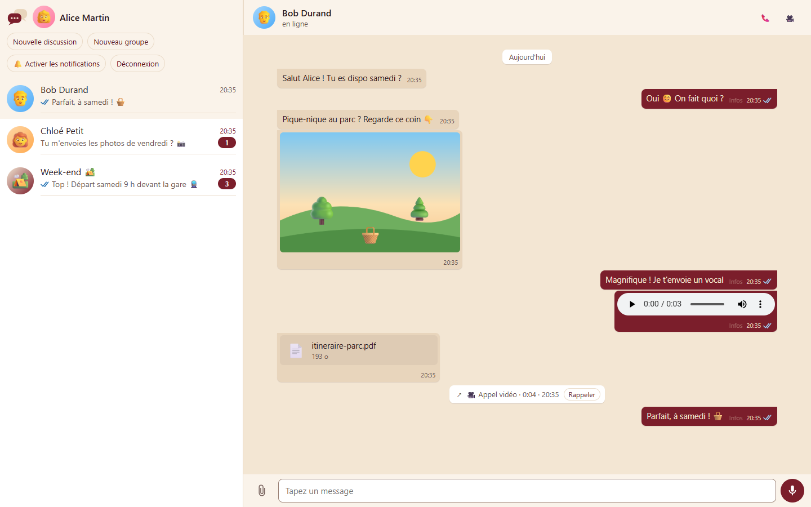
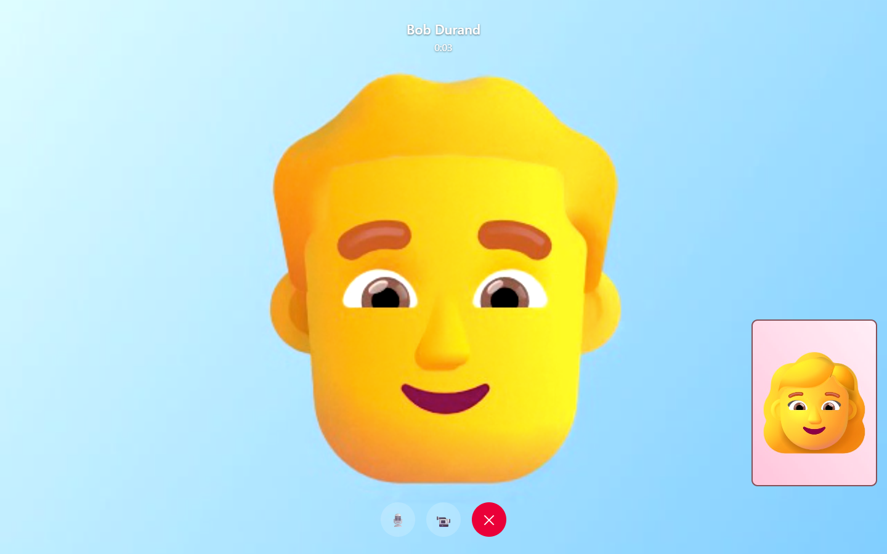
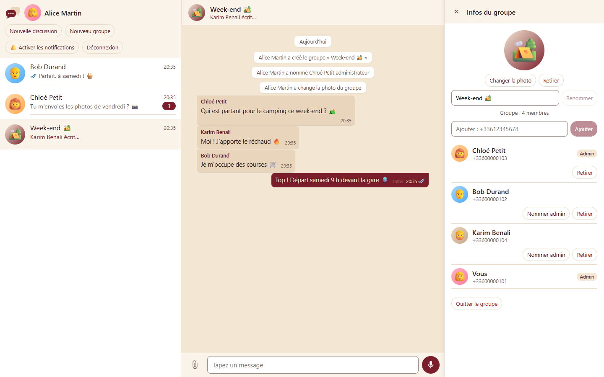
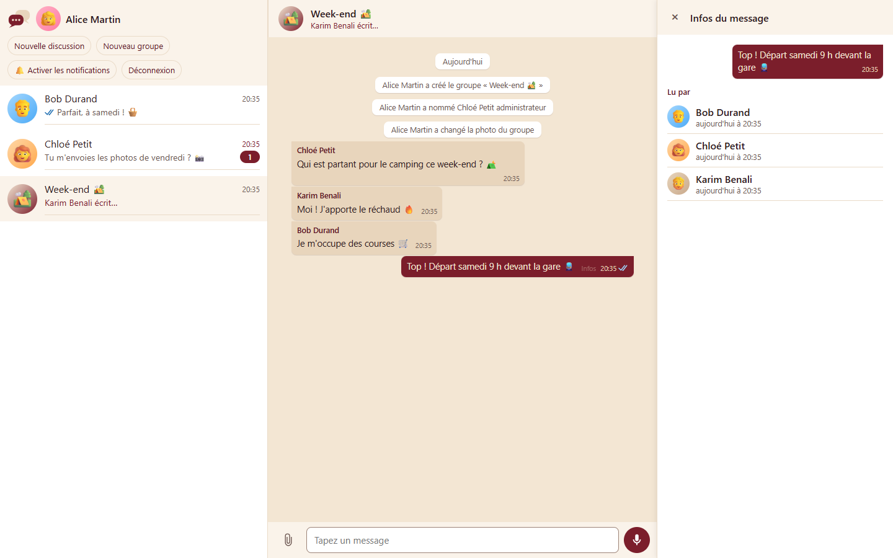
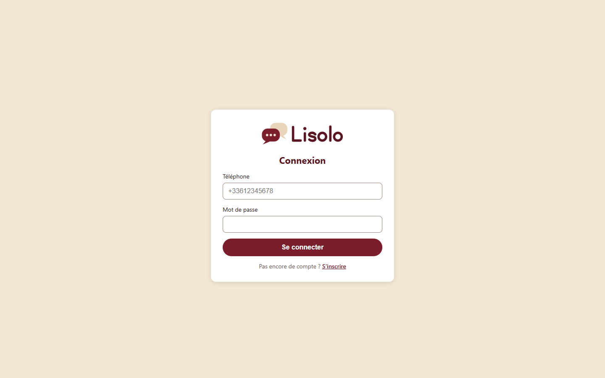
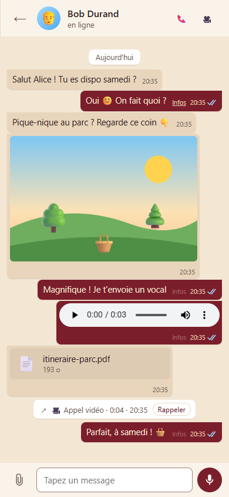
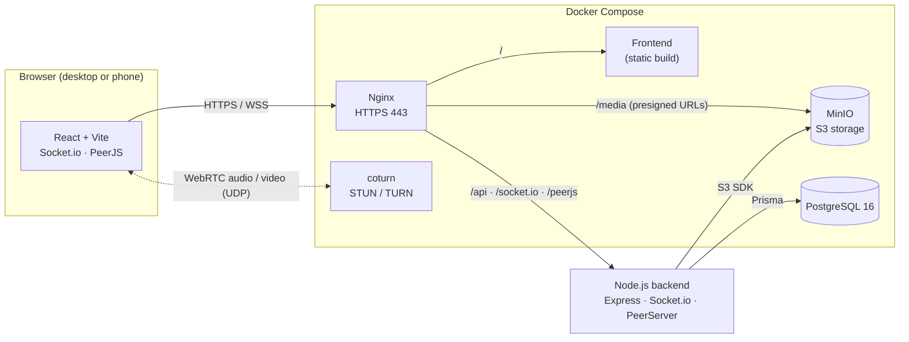
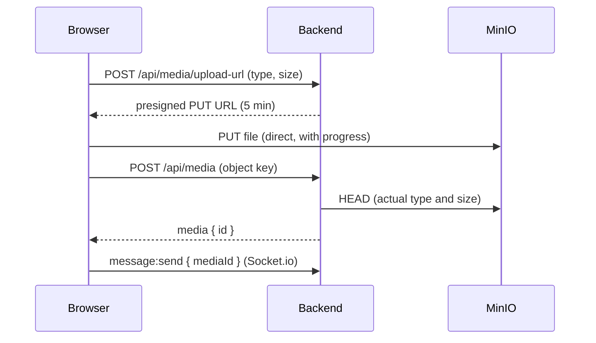

<p align="center"></p>

# Lisolo

[Français](README.md) · **English**

[](https://github.com/boviceballey9-ui/lisolo_conversation/actions/workflows/backend-tests.yml)
[](LICENSE)


**Lisolo** is a messaging app built from scratch to **learn** everything behind this kind of product (in the spirit of WhatsApp): real-time messaging, read receipts, groups, file uploads, WebRTC audio and video calls, push notifications, and HTTPS deployment behind a reverse proxy.

The project was built in 12 steps, each one tested and committed separately.

## Why "Lisolo"?

In **Lingala**, a language spoken in the Democratic Republic of the Congo and the Republic of the Congo, *lisolo* means **"conversation, discussion"**. The name simply says what the app does: get people talking. The logo carries the same idea: two speech bubbles answering each other.

## Visual identity

| Color | Role |
|---|---|
|  | **Burgundy**: sent bubbles, buttons, links, accents |
|  | **Dark burgundy**: titles, author names, call screens |
|  | **Light beige**: chat background, text on burgundy |
|  | **Medium beige**: received bubbles |

Contrast is checked against **WCAG AA** for every color pair in use: 25 pairs, for example 8.3:1 for sent-bubble text and 11.5:1 for received-bubble text. Run the check again with `cd frontend ; npm run check:contrast`. Colors are defined in a single place: the CSS variables in `:root`. The user interface is in French.



## Screenshots

| Video call (WebRTC) | Group: members and roles |
|---|---|
|  |  |
| **"Read by": group read receipts** | **Sign in** |
|  |  |

<p align="center"></p>

## Features

- **Accounts**: sign up and sign in with a phone number. JWT with an access token (15 min) and a refresh token (7 days), passwords hashed with bcrypt.
- **Real-time chat** with Socket.io: optimistic sending, paginated history, unread counters.
- **Delivery receipts**: ✓ sent, ✓✓ delivered, blue ✓✓ read. In groups, the ticks only turn blue once *every* member has read the message, and a "Message info" screen lists who read it and when.
- **Presence**: "online", "last seen today at 14:05" (multiple tabs handled), and "Alice is typing…".
- **Groups**: admin and member roles, adding and removing members, promoting admins, leaving (the oldest member takes over), system messages.
- **Media**: photos, videos, documents, **voice messages** (hold-to-record button), profile pictures and group photos. Files go straight from the browser to storage, with a progress bar.
- **1-to-1 audio and video calls** over WebRTC: ringing, busy, missed calls, mute mic or camera, call history in the chat.
- **Push notifications** (Web Push): a message arrives while no tab is open, and the phone or PC shows "Alice: Tu es dispo samedi ?". Clicking it opens the right conversation. A local notification is shown when the tab is merely in the background.
- **HTTPS** behind Nginx, testable from a phone on the same Wi-Fi.

## Architecture



Sending a photo: the backend **signs** a permission, but the file never goes through it.



## Tech stack

| | |
|---|---|
| **Frontend** | React 18, Vite, TypeScript, Socket.io client, PeerJS |
| **Backend** | Node.js, Express 4, TypeScript (ESM), Socket.io 4, PeerServer, Zod, JWT, bcrypt |
| **Data** | PostgreSQL 16, Prisma 7 |
| **Files** | MinIO (S3-compatible), AWS SDK v3, presigned URLs |
| **Calls** | WebRTC, PeerJS, coturn (STUN/TURN, short-lived credentials) |
| **Notifications** | Web Push (service worker, VAPID, RFC 8291 encryption), `web-push` |
| **Infrastructure** | Docker Compose, Nginx (HTTPS, HTTP/2, WebSocket), mkcert |
| **Quality** | Vitest + Supertest: 143 tests against a real database and a real MinIO, GitHub Actions |

## Getting started

Requirements: [Node.js](https://nodejs.org/) 20 or later, [Docker Desktop](https://www.docker.com/products/docker-desktop/). Commands are for Windows PowerShell.

### 1. Configuration

```powershell
git clone https://github.com/boviceballey9-ui/lisolo_conversation.git
cd lisolo_conversation
Copy-Item .env.example .env
```

In `.env`, replace the `change_me` and `remplacez_moi…` values: PostgreSQL and MinIO passwords, JWT secrets, `TURN_SECRET`. For push notifications, generate VAPID keys (`cd backend ; npm install ; npx web-push generate-vapid-keys`) and put them in `VAPID_PUBLIC_KEY` / `VAPID_PRIVATE_KEY`. To generate a random value:

```powershell
[Convert]::ToBase64String((1..48 | ForEach-Object { Get-Random -Maximum 256 }))
```

### 2. Development mode (Vite, http://localhost:5173)

```powershell
docker compose up -d postgres minio coturn

# Terminal 1: backend (port 4000)
cd backend
npm install
npx prisma migrate deploy
npm run dev

# Terminal 2: frontend (port 5173)
cd frontend
npm install
npm run dev
```

Open http://localhost:5173, create two accounts (a normal window and a private window), then click "Nouvelle discussion" and enter the other account's phone number.

### 3. HTTPS mode with Nginx (production build, reachable from a phone)

```powershell
# Local certificate for localhost, 127.0.0.1 and the PC's Wi-Fi IP
# (once: winget install FiloSottile.mkcert ; mkcert -install)
powershell -ExecutionPolicy Bypass -File scripts\gen-certs.ps1
```

Put the printed IP into `.env` (`TURN_EXTERNAL_IP`, `TURN_HOST`, `CORS_ORIGINS`), then:

```powershell
docker compose up -d --build                  # Postgres, MinIO, coturn and Nginx (builds the frontend)
cd backend; npx prisma migrate deploy; npm run build; npm start
```

→ **https://localhost**, or `https://<PC-IP>` from a phone on the same Wi-Fi. On the phone, first install the root certificate `rootCA.pem` from `mkcert -CAROOT` (never `rootCA-key.pem`) under *Settings → Security → Encryption & credentials → Install a certificate → CA certificate*.

### 4. Tests

```powershell
cd backend
npm test        # 143 tests, on a dedicated database and bucket, created and cleaned automatically
```

All routes and Socket.io events are listed in **[docs/api.md](docs/api.md)** (in French).

## Technical choices

- **Files never go through the backend.** The backend checks the file type and size, then signs a presigned URL valid for 5 minutes. Both type *and* size are part of the signature, so MinIO itself rejects any other upload. After the upload, the backend checks the actual object again before saving it.
- **Two channels for calls.** Socket.io handles ringing: notifying every tab, detecting busy or offline users, saving the call history. PeerJS is only used once the call is picked up, to set up the WebRTC connection. Audio and video travel encrypted, directly between browsers.
- **Push notifications without duplicates**: the server only sends a push to recipients with no open tab. If a tab is in the background, it shows a local notification itself. The content is encrypted for the subscribed browser only: the push service (Google, Mozilla, Microsoft) only carries unreadable bytes, and a test proves it by decrypting the request.
- **Short-lived TURN credentials** ("TURN REST API"): the backend derives them with an HMAC, using a secret shared with coturn. No fixed password ever reaches the browser.
- **Permissions enforced on the server**, with tests proving it without any UI: 404 instead of 403 so the existence of a group or a file is never revealed.
- **Concurrency**: group changes run in a transaction with `SELECT … FOR UPDATE`. Without this lock, two admins leaving at the same time leave a group with no admin, and a test demonstrates it.
- **Ephemeral state in memory** (presence, "typing…", ongoing calls) and durable data in the database (messages, `last_seen`, call history).
- **Realistic integration tests** against a real PostgreSQL and a real MinIO, with real sockets.

## Problems solved along the way

- **The `minio/minio` image was removed from Docker Hub.** I switched to `cgr.dev/chainguard/minio`, which runs as a non-root user (UID 65532). A bind-mounted Windows folder then causes permission errors; a **named Docker volume** avoids them.
- **coturn on Docker Desktop**: `network_mode: host` does not work there, so port 3478 and a UDP relay port range have to be published explicitly. Other traps:
  - the image entrypoint passes its arguments to `echo`, which swallows the `-n` option;
  - `--no-cli` is deprecated;
  - authentication moved from a fixed password to a shared HMAC secret.
- **WebSocket behind Nginx**: by default, Nginx speaks HTTP/1.0 to the backend, strips the `Upgrade` and `Connection` headers, and closes an idle connection after 60 s. It needs `proxy_http_version 1.1`, those two headers set again, and longer timeouts.
- **Two WebSocket servers on one port**: PeerJS's `ws` server answered 400 and closed every other connection, including `/socket.io`. I switched it to `noServer` mode with manual routing of requests. Without this fix, every Socket.io test fails.
- **Presigned URLs over HTTPS**: the signature covers the host. The backend therefore signs for the address the client actually used (localhost or the Wi-Fi IP), and Nginx forwards the `Host` header unchanged to MinIO. Recent AWS SDK versions also added a CRC32 checksum that broke uploads from the browser.
- Also: a native PostgreSQL silently holding port 5432; Prisma 7 no longer regenerating its client after a migration; UTF-8 encoding with PowerShell 5.1.

## License

[MIT](LICENSE) © 2026 Bovice
