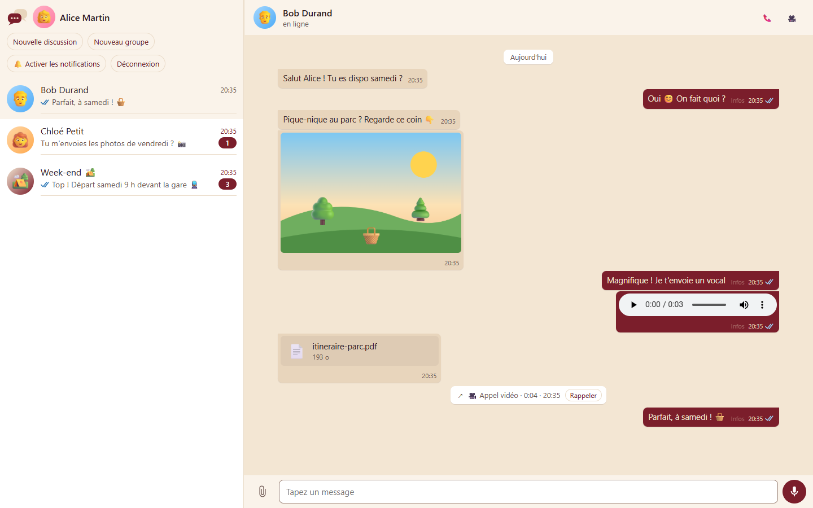
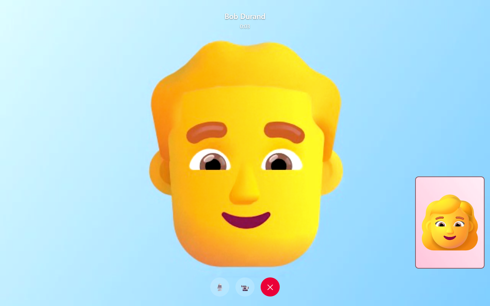
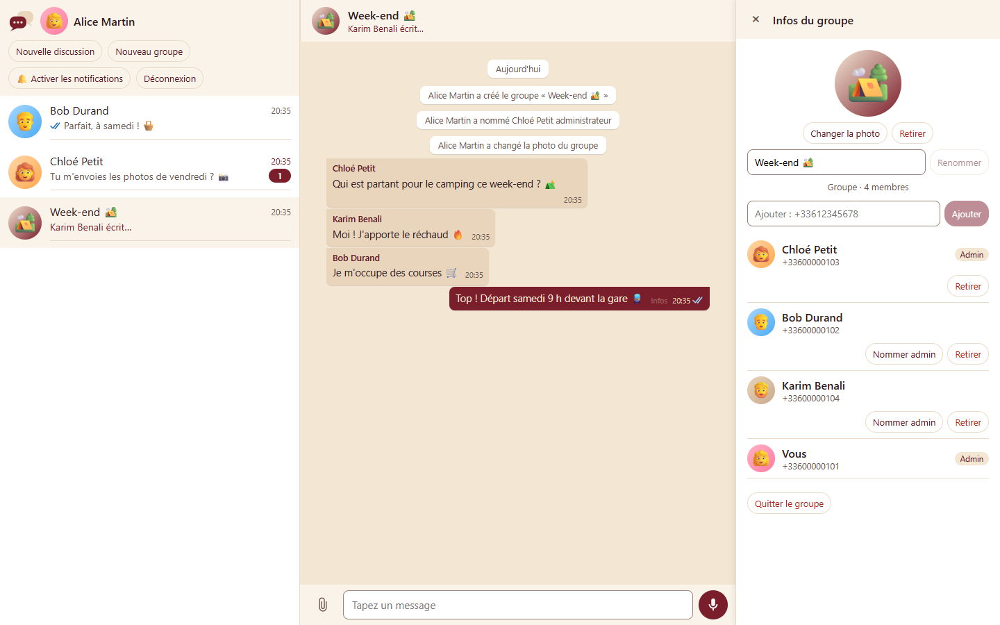
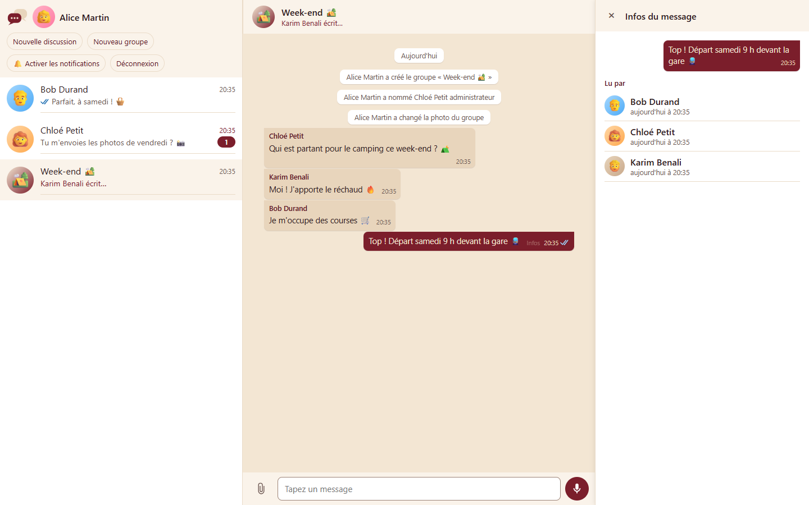
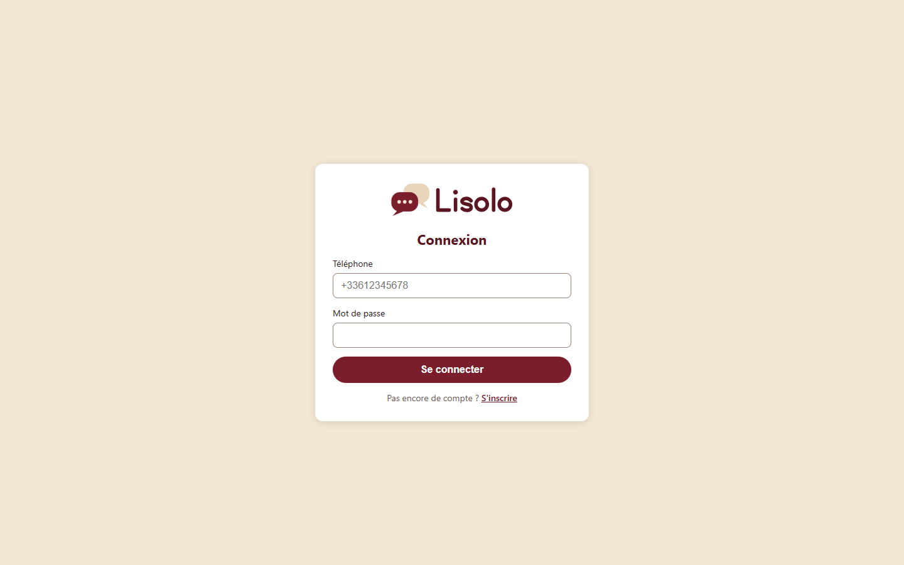
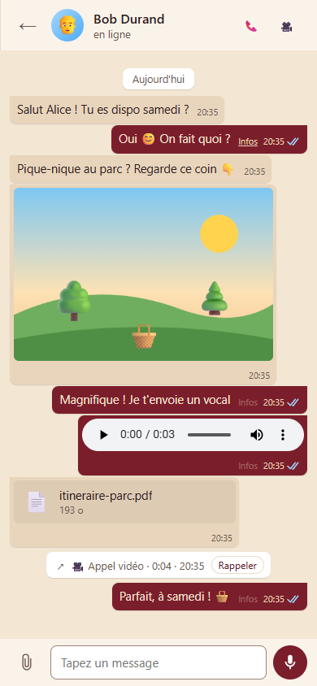
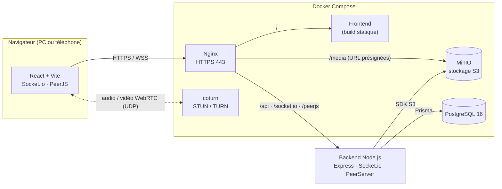
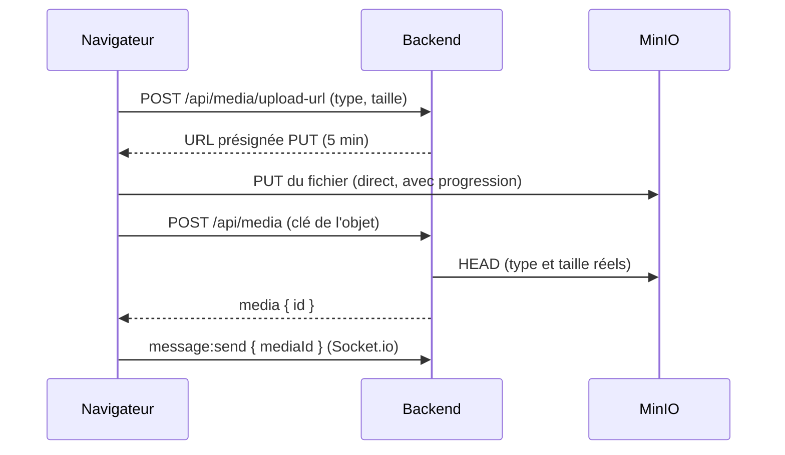

<p align="center"></p>

# Lisolo

**Français** · [English](README.en.md)

[](https://github.com/boviceballey9-ui/lisolo_conversation/actions/workflows/backend-tests.yml)
[](LICENSE)


**Lisolo** est une messagerie construite de zéro pour **apprendre** tout ce qu'il y a derrière ce genre d'application (dans l'esprit de WhatsApp) : temps réel, accusés de lecture, groupes, envoi de fichiers, appels audio et vidéo en WebRTC, notifications push et déploiement HTTPS derrière un reverse proxy.

Le projet a été mené en 12 étapes, chacune testée et commitée séparément.

## Pourquoi « Lisolo » ?

En **lingala**, langue parlée en République démocratique du Congo et en République du Congo, *lisolo* signifie **« conversation, discussion »**. Le nom dit simplement ce que fait l'application : faire discuter les gens. Le logo reprend l'idée : deux bulles qui se répondent.

## Charte graphique

| Couleur | Rôle |
|---|---|
|  | **Bordeaux** : bulles envoyées, boutons, liens, accents |
|  | **Bordeaux foncé** : titres, nom des auteurs, écrans d'appel |
|  | **Beige clair** : fond des discussions, texte sur bordeaux |
|  | **Beige moyen** : bulles reçues |

Contraste vérifié **WCAG AA** pour chaque association utilisée : 25 paires, par exemple 8,3:1 pour le texte des bulles envoyées et 11,5:1 pour celui des bulles reçues. La vérification se relance avec `cd frontend ; npm run check:contrast`. Les couleurs ne sont définies qu'à un seul endroit : les variables CSS de `:root`.



## Captures d'écran

| Appel vidéo (WebRTC) | Groupe : membres et rôles |
|---|---|
|  |  |
| **« Lu par » : accusés de lecture en groupe** | **Connexion** |
|  |  |

<p align="center"></p>

## Fonctionnalités

- **Comptes** : inscription et connexion par numéro de téléphone. JWT avec access token (15 min) et refresh token (7 j), mots de passe hachés avec bcrypt.
- **Chat temps réel** avec Socket.io : envoi optimiste, historique paginé, compteur de non-lus.
- **Accusés de réception** ✓ envoyé, ✓✓ reçu, ✓✓ bleu lu. En groupe, le bleu n'apparaît que lorsque *tous* les membres ont lu, et l'écran « Infos du message » liste qui a lu et quand.
- **Présence** : « en ligne », « vu(e) aujourd'hui à 14:05 » (plusieurs onglets gérés), et « Alice écrit… ».
- **Groupes** : rôles admin et membre, ajout, retrait, nomination d'admins, départ (le plus ancien membre prend le relais), messages système.
- **Médias** : photos, vidéos, documents, **messages vocaux** (bouton micro maintenu), photo de profil et photo de groupe. Les fichiers vont directement du navigateur au stockage, avec une barre de progression.
- **Appels audio et vidéo 1-à-1** en WebRTC : sonnerie, occupé, appel manqué, coupure du micro ou de la caméra, historique des appels dans la conversation.
- **Notifications push** (Web Push) : un message arrive alors qu'aucun onglet n'est ouvert, et le téléphone ou le PC affiche « Alice : Tu es dispo samedi ? ». Un clic ouvre la bonne conversation. Notification locale si l'onglet est simplement en arrière-plan.
- **HTTPS** derrière Nginx, testable depuis un téléphone sur le Wi-Fi.

## Architecture



Envoi d'une photo : le backend **signe** une autorisation, mais le fichier ne passe jamais par lui.



## Stack technique

| | |
|---|---|
| **Frontend** | React 18, Vite, TypeScript, Socket.io client, PeerJS |
| **Backend** | Node.js, Express 4, TypeScript (ESM), Socket.io 4, PeerServer, Zod, JWT, bcrypt |
| **Données** | PostgreSQL 16, Prisma 7 |
| **Fichiers** | MinIO (compatible S3), SDK AWS v3, URL présignées |
| **Appels** | WebRTC, PeerJS, coturn (STUN/TURN, identifiants temporaires) |
| **Notifications** | Web Push (service worker, VAPID, chiffrement RFC 8291), `web-push` |
| **Infrastructure** | Docker Compose, Nginx (HTTPS, HTTP/2, WebSocket), mkcert |
| **Qualité** | Vitest + Supertest : 143 tests sur une vraie base et un vrai MinIO, GitHub Actions |

## Installation

Prérequis : [Node.js](https://nodejs.org/) 20 ou plus, [Docker Desktop](https://www.docker.com/products/docker-desktop/). Les commandes sont pour Windows PowerShell.

### 1. Configuration

```powershell
git clone https://github.com/boviceballey9-ui/lisolo_conversation.git
cd lisolo_conversation
Copy-Item .env.example .env
```

Dans `.env`, remplacez les valeurs `change_me` et `remplacez_moi…` : mots de passe PostgreSQL et MinIO, secrets JWT, `TURN_SECRET`. Pour les notifications push, générez les clés VAPID (`cd backend ; npm install ; npx web-push generate-vapid-keys`) et reportez-les dans `VAPID_PUBLIC_KEY` / `VAPID_PRIVATE_KEY`. Une valeur aléatoire s'obtient avec :

```powershell
[Convert]::ToBase64String((1..48 | ForEach-Object { Get-Random -Maximum 256 }))
```

### 2. Mode développement (Vite, http://localhost:5173)

```powershell
docker compose up -d postgres minio coturn

# Terminal 1 : backend (port 4000)
cd backend
npm install
npx prisma migrate deploy
npm run dev

# Terminal 2 : frontend (port 5173)
cd frontend
npm install
npm run dev
```

Ouvrez http://localhost:5173, créez deux comptes (fenêtre normale et fenêtre privée), puis « Nouvelle discussion » avec le numéro de l'autre compte.

### 3. Mode HTTPS avec Nginx (build de production, accessible depuis un téléphone)

```powershell
# Certificat local pour localhost, 127.0.0.1 et l'IP Wi-Fi du PC
# (une fois : winget install FiloSottile.mkcert ; mkcert -install)
powershell -ExecutionPolicy Bypass -File scripts\gen-certs.ps1
```

Reportez l'IP affichée dans `.env` (`TURN_EXTERNAL_IP`, `TURN_HOST`, `CORS_ORIGINS`), puis :

```powershell
docker compose up -d --build                  # Postgres, MinIO, coturn et Nginx (construit le frontend)
cd backend; npx prisma migrate deploy; npm run build; npm start
```

→ **https://localhost**, ou `https://<IP-du-PC>` depuis un téléphone sur le même Wi-Fi. Pour le téléphone, il faut d'abord installer le certificat racine `rootCA.pem` donné par `mkcert -CAROOT` (jamais `rootCA-key.pem`) dans *Paramètres → Sécurité → Chiffrement et identifiants → Installer un certificat → Certificat CA*.

### 4. Tests

```powershell
cd backend
npm test        # 143 tests, sur une base et un bucket dédiés, créés et vidés automatiquement
```

La liste des routes et des événements Socket.io est dans **[docs/api.md](docs/api.md)**.

## Choix techniques

- **Le fichier ne passe jamais par le backend.** Le backend vérifie le type et la taille, puis signe une URL présignée valable 5 minutes. Type *et* taille font partie de la signature : MinIO refuse lui-même tout autre envoi. Après l'envoi, le backend revérifie l'objet réel avant de l'enregistrer.
- **Deux canaux pour les appels.** Socket.io gère la sonnerie : prévenir tous les onglets, détecter l'occupé ou l'absence, enregistrer l'historique. PeerJS ne sert qu'après le décroché, pour établir la connexion WebRTC. Le son et l'image vont de navigateur à navigateur, chiffrés.
- **Notifications push sans doublon** : le serveur n'envoie un push qu'aux destinataires sans aucun onglet ouvert. Si un onglet est en arrière-plan, c'est lui qui affiche une notification locale. Le contenu est chiffré pour le seul navigateur abonné : le service push (Google, Mozilla, Microsoft) ne transporte que des octets illisibles, et un test le prouve en déchiffrant la requête.
- **Identifiants TURN temporaires** (« TURN REST API ») : le backend les fabrique par HMAC avec un secret partagé avec coturn. Aucun mot de passe fixe n'arrive dans le navigateur.
- **Permissions vérifiées côté serveur**, avec des tests qui le prouvent sans interface : 404 plutôt que 403 pour ne pas révéler l'existence d'un groupe ou d'un média.
- **Concurrence** : les changements d'un groupe passent dans une transaction avec `SELECT … FOR UPDATE`. Sans ce verrou, deux admins qui partent en même temps laissent un groupe sans admin, et un test le démontre.
- **État éphémère en mémoire** (présence, « écrit… », appels en cours) et données durables en base (messages, `last_seen`, historique des appels).
- **Tests d'intégration réalistes** sur un vrai PostgreSQL et un vrai MinIO, avec de vrais sockets.

## Difficultés résolues

- **L'image `minio/minio` a été retirée de Docker Hub.** Je l'ai remplacée par `cgr.dev/chainguard/minio`, qui tourne en utilisateur non-root (UID 65532). Un dossier Windows monté provoque alors des erreurs de permissions ; un **volume nommé** Docker les évite.
- **coturn sous Docker Desktop** : `network_mode: host` n'y fonctionne pas, il faut publier explicitement le port 3478 et une plage de ports de relais UDP. Autres pièges :
  - l'entrypoint de l'image passe ses arguments à `echo`, qui avale l'option `-n` ;
  - `--no-cli` est déprécié ;
  - l'authentification est passée d'un mot de passe fixe à un secret HMAC partagé.
- **WebSocket derrière Nginx** : par défaut, Nginx parle HTTP/1.0 au backend, supprime les en-têtes `Upgrade` et `Connection`, et coupe une connexion silencieuse au bout de 60 s. Il faut `proxy_http_version 1.1`, recréer ces deux en-têtes et allonger les délais.
- **Deux serveurs WebSocket sur un même port** : le serveur `ws` de PeerJS répondait 400 et fermait toutes les autres connexions, y compris `/socket.io`. Je l'ai passé en mode `noServer`, avec un aiguillage manuel des requêtes. Sans ce correctif, les tests Socket.io échouent tous.
- **URL présignées et HTTPS** : la signature porte sur l'hôte. Le backend signe donc pour l'adresse réellement utilisée par le client (localhost ou l'IP Wi-Fi), et Nginx transmet l'en-tête `Host` intact à MinIO. Les versions récentes du SDK AWS ajoutaient aussi une somme de contrôle CRC32 qui cassait les envois depuis le navigateur.
- Et aussi : un PostgreSQL natif qui occupait silencieusement le port 5432 ; Prisma 7, qui ne régénère plus son client après une migration ; l'encodage UTF-8 avec PowerShell 5.1.

## Licence

[MIT](LICENSE) © 2026 Bovice
